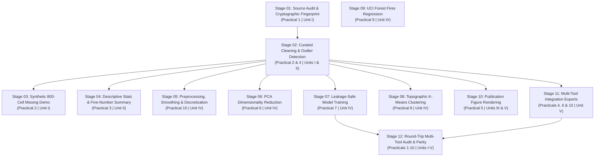

# End-to-End Pipeline Architecture & Lifecycle Management Guide

**Project:** Forest Cover Type Prediction & Wildfire-Risk Analysis  
**Subsystems:** Python Core Engine ↔ Supabase (PostgreSQL) ↔ KNIME Analytics Platform ↔ Tableau Desktop ↔ FastAPI Backend ↔ Next.js Web Application  
**Execution Engine:** `python_src/pipeline.py` (`PipelineDAG`)  
**CLI Runner:** `scripts/run_all_pipelines.py`  

---

## 1. Executive Summary & Design Principles

Rather than treating data cleaning, feature engineering, statistical modeling, visual workflows, and business intelligence dashboards as disparate standalone scripts, this platform organizes all 10 academic practicals and Units I–V into a **formally managed, dependency-preserving Directed Acyclic Graph (DAG)**.

Every computational step operates under strict software engineering principles:
1. **Pre-condition and Post-condition Assertions:** No stage executes unless its prerequisite inputs are cryptographically present and verified for minimum payload size.
2. **Deterministic Artifact Verification:** Every stage produces structured, versioned artifacts (clean Parquet, JSON metrics, CSV exports, or Joblib model pipelines) recorded in `reports/pipeline_run_manifest.json`.
3. **Multi-Tool Round-Trip Integration:** Integration with KNIME, Tableau, and Supabase is not a one-way CSV dump. Data flows bidirectionally: Python supplies curated extracts, KNIME executes visual modeling nodes, KNIME outputs flow back into Python for statistical parity audits (tolerance $\le 2.0\%$), and Supabase synchronizes relational tables for Tableau and FastAPI consumers.
4. **Resilient CLI & API Management:** The pipeline can be executed, smoke-tested (`--fast`), or validated (`--validate`) via CLI, monitored via FastAPI endpoints (`/api/pipeline/status`, `/api/pipeline/stages`), and inspected interactively in the Next.js web application.

---

## 2. Pipeline DAG Topology & Execution Lineage

The pipeline consists of **12 strictly ordered stages**. Below is the directed acyclic graph lineage showing root, transformation, parallel branches, and convergence:



---

## 3. Detailed Stage-by-Stage Specification

| Stage ID | Stage Name | Academic Practical | Syllabus Unit | Input Checkpoints | Output Checkpoints | Execution Script |
|:---|:---|:---|:---|:---|:---|:---|
| **`01_SOURCE_AUDIT`** | Source Dataset Fingerprinting | Practical 1 | Unit I | `data/raw/covtype.csv` ($\ge 1 \text{ MB}$) | `reports/data_quality/source_manifest.json` | `scripts/01_audit_source.py` |
| **`02_DATA_CLEANING`** | Curated Cleaning & Outliers | Practical 2 & 4 | Units I & II | `data/raw/covtype.csv` | `data/processed/covtype_clean.parquet`<br/>`reports/data_quality/outlier_comparison.csv` | `scripts/02_run_cleaning.py` |
| **`03_SYNTHETIC_CLEANING_DEMO`** | 800-Cell Missing Value Experiment | Practical 2 | Unit I | `data/processed/covtype_clean.parquet` | `data/processed/covtype_missing_values_demo_clean.csv`<br/>`reports/data_quality/synthetic_demo_audit.json` | `scripts/03_synthetic_cleaning_demo.py` |
| **`04_DESCRIPTIVE_STATISTICS`** | Five-Number Summary & Moments | Practical 3 | Unit II | `data/processed/covtype_clean.parquet` | `reports/statistics/five_number_summary.csv`<br/>`reports/statistics/descriptive_statistics.csv` | `scripts/05_descriptive_statistics.py` |
| **`05_PREPROCESSING_EXPERIMENTS`** | Smoothing, Scaling & Discretization | Practical 10 | Unit IV | `data/processed/covtype_clean.parquet` | `reports/statistics/preprocessing_comparison.csv`<br/>`reports/statistics/pearson_correlation.csv`<br/>`reports/statistics/chi2_scores.csv` | `scripts/06_preprocessing_experiments.py` |
| **`06_FEATURE_SELECTION_PCA`** | PCA Dimensionality Reduction | Practical 6 | Unit IV | `data/processed/covtype_clean.parquet` | `reports/statistics/pca_report.json`<br/>`models/pca_model.joblib` | `scripts/07_feature_selection_pca.py` |
| **`07_CLASSIFICATION_TRAINING`** | Supervised Model Training | Practical 7 | Unit IV | `data/processed/covtype_clean.parquet` | `models/random_forest.joblib` ($\ge 100 \text{ KB}$)<br/>`models/decision_tree.joblib` ($\ge 100 \text{ KB}$)<br/>`reports/statistics/classification_metrics.json` | `scripts/08_train_classifiers.py` |
| **`08_CLUSTERING_ANALYSIS`** | Topographic K-Means Clustering | Practical 8 | Unit IV | `data/processed/covtype_clean.parquet` | `reports/statistics/cluster_profiles.csv`<br/>`reports/statistics/cluster_elbow_silhouette.csv` | `scripts/09_run_clustering.py` |
| **`09_FIRES_REGRESSION`** | Burned Area Regression | Practical 9 | Unit IV | `data/external/forestfires.csv` | `reports/statistics/forest_fires_regression_summary.json` | `scripts/10_train_fires_regression.py` |
| **`10_EDA_VISUALIZATIONS`** | Publication Figures (18 charts) | Practical 5 | Units III & V | `data/processed/covtype_clean.parquet` | `reports/figures/treemap_cover_type.png`<br/>`reports/figures/radial_cover_distribution.png`<br/>`reports/figures/confusion_matrix_random_forest.png` | `scripts/04_generate_eda.py` |
| **`11_INTEGRATION_EXPORTS`** | Multi-Tool Payload Generation | Practical 4, 6, 10 | Unit V | `data/processed/covtype_clean.parquet` | `exports/knime/covertype_curated.csv`<br/>`exports/tableau/wildfire_screening_aggregates.csv` | `scripts/11_export_integrations.py` |
| **`12_ROUNDTRIP_AUDIT`** | KNIME/Tableau Parity & Ingestion | Practicals 1-10 | Units I-V | `exports/knime/covertype_curated.csv`<br/>`exports/knime_outputs/knime_classification_metrics.csv` | `reports/knime_tableau_integration_report.json` | `scripts/13_sync_knime_tableau_results.py` |

---

## 4. Multi-Tool Integration & Round-Trip Protocol

### 4.1 Python to KNIME Payload Channel (`exports/knime/`)
Stage 11 exports 10 standardized CSV files tailored for KNIME nodes:
- `covertype_curated.csv` (50,000 stratified rows $\times$ 55 columns, clean, 0 nulls)
- `covertype_missing_demo.csv` (10,000 rows with exactly 800 synthetic missing values)
- `class_distribution.csv` (Target species breakdown across 7 classes)
- `feature_selection_results.csv` (Continuous predictor mutual information & ANOVA F-scores)
- `clustering_results.csv` (K-Means assigned clusters with PCA coordinates)
- `forest_fires_regression_results.csv` (UCI Forest Fires meteorological predictors and log1p area)

### 4.2 KNIME to Python Ingestion Channel (`exports/knime_outputs/`)
Workflows executed in KNIME write their outputs to `exports/knime_outputs/`:
- `knime_classification_metrics.csv`: Precision, recall, and accuracy from KNIME Decision Tree and Random Forest nodes.
- `knime_synthetic_imputation_audit.csv`: Verified median imputation results on 800 missing cells.
- `knime_pca_variance.csv`: Eigenvalues and cumulative variance from KNIME PCA Compute.
- `knime_cluster_centroids.csv`: 4-cluster topographic terrain centroids.
- `knime_regression_metrics.csv`: $R^2$ and RMSE scores from KNIME Linear Regression.

### 4.3 Python Parity Assertion & Supabase Synchronization
Stage 12 (`python_src/knime_integration.py`) ingests KNIME outputs and performs automated assertions:
$$\Delta = |\text{Metric}_{\text{Python}} - \text{Metric}_{\text{KNIME}}| \le 2.0\%$$
Upon parity confirmation, it generates `reports/knime_tableau_integration_report.json` and syncs summary data to Supabase (PostgreSQL) schema tables (`source_manifest`, `classification_metrics`, `cluster_profiles`, `wildfire_screening_aggregates`).

### 4.4 Tableau Dashboard Integration (`tableau/`)
Tableau workbooks read from `exports/tableau/` and Supabase:
- `01_executive_forest_cover_overview.twb`: Species elevation distribution and wilderness areas.
- `02_topographic_wildfire_risk.twb`: Slope, solar radiation, and ignition distance screening.
- `03_model_governance_parity.twb`: Multi-model accuracy comparison and KNIME parity audit.

---

## 5. Pipeline Management CLI

The CLI provides three operational modes:

```powershell
# 1. Checkpoint Validation Mode (Instant: audits all 12 stages without re-computation)
python scripts/run_all_pipelines.py --validate

# 2. Fast Pipeline Execution Mode (Runs smoke-testing configuration)
python scripts/run_all_pipelines.py --fast

# 3. Full Production Pipeline Execution (Sequential DAG execution with checkpoint checks)
python scripts/run_all_pipelines.py
```

### CLI Output Example:
```text
================================================================================
 FOREST COVER TYPE & WILDFIRE-RISK ANALYSIS: PIPELINE ORCHESTRATOR
================================================================================

--> Mode: VALIDATION CHECKPOINT AUDIT ONLY
[PASS] 01_SOURCE_AUDIT            | Practical 1    | VALIDATED
[PASS] 02_DATA_CLEANING           | Practical 2 & 4 | VALIDATED
[PASS] 03_SYNTHETIC_CLEANING_DEMO | Practical 2    | VALIDATED
[PASS] 04_DESCRIPTIVE_STATISTICS  | Practical 3    | VALIDATED
[PASS] 05_PREPROCESSING_EXPERIMENTS | Practical 10   | VALIDATED
[PASS] 06_FEATURE_SELECTION_PCA   | Practical 6    | VALIDATED
[PASS] 07_CLASSIFICATION_TRAINING | Practical 7    | VALIDATED
[PASS] 08_CLUSTERING_ANALYSIS     | Practical 8    | VALIDATED
[PASS] 09_FIRES_REGRESSION        | Practical 9    | VALIDATED
[PASS] 10_EDA_VISUALIZATIONS      | Practical 5    | VALIDATED
[PASS] 11_INTEGRATION_EXPORTS     | Practical 4, 6 & 10 | VALIDATED
[PASS] 12_ROUNDTRIP_AUDIT         | Practicals 1-10 | VALIDATED
================================================================================
Artifact Validation: 12/12 Stages Passed.
```

---

## 6. REST API Endpoints for Pipeline Governance

The FastAPI backend exposes native endpoints for real-time pipeline monitoring and management:

1. `GET /api/pipeline/status`: Returns current pipeline validation status (`VALIDATED` / `DEGRADED`), stage-by-stage verification details, and the most recent execution manifest (`reports/pipeline_run_manifest.json`).
2. `GET /api/pipeline/stages`: Returns full DAG topology including nodes, directed edges, input/output checkpoints, and practical mappings.
3. `POST /api/pipeline/validate`: Re-audits all stage checkpoints dynamically on demand.
4. `GET /api/integrations/roundtrip-audit`: Returns the bidirectional KNIME and Tableau statistical parity matrix.

---

## 7. Web Application Management Interface

In the Next.js web application (`frontend/src/app/page.tsx`), the **"Pipeline & DAG"** view allows users, mentors, and evaluators to:
- Visually inspect the 12-stage DAG execution hierarchy.
- View input and output artifact verification status in real time.
- Click any stage node to view its syllabus unit, practical ID, underlying Python script, and runtime metrics.
- Trigger live checkpoint re-audits via the "Verify Checkpoints" button.
- Inspect the bidirectional round-trip data lineage connecting Python, KNIME, Tableau, and Supabase.
